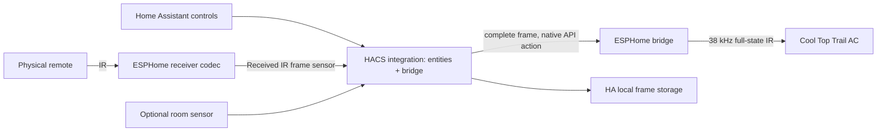

# Technical design (TD)

## Architecture

The custom integration owns one climate entity and eight auxiliaries. Built-in
ESPHome owns discovery, encrypted connection, native API action registration,
connection recovery and transport sensors. No second ESPHome connection or
third-party Python runtime requirement is introduced; the manifest declares
`esphome` as a dependency. The firmware has no climate entity and thus creates
no competing climate controller.

HA configuration binds one ESPHome device, plus an optional room-temperature
source. `discovery.py` resolves it at each setup: the action is
`esphome.<node>_send_frame`, using the node name stored by the ESPHome entry and
the ESPHome integration's naming; the receiver is the device's sensor whose
original name is `Received IR frame`. Without one, the default profile is used.
The device ID is the entry's unique ID, so renaming entities cannot create
duplicates. Changing the bridge firmware's entities requires a reload.

## Modules and runtime interfaces

| Module | Responsibility |
| --- | --- |
| `protocol.py` | Pure wire codec, strict semantic validation, BCD, safe partial mutation of full frames |
| `coordinator.py` | State-change subscriptions, native action invocation, serialized commands, persistence and availability |
| `entity.py` | Device identity and push subscription lifecycle |
| `climate.py` | Standard HVAC/target/fan/preset service methods, optional measured temperature |
| `switch.py`, `time.py`, `button.py` | Auxiliary boolean settings, stored schedule times and explicit clock sync |
| `sensor.py` | Readiness and source/frame/session timestamp diagnostics |
| `config_flow.py` | UI create/reconfigure flow, names, duplicate device protection |
| `discovery.py` | Resolve an ESPHome device to its send action, optional receiver sensor and entities |
| `esp32/webasto_ir.h` | Standalone C++ wire parser/encoder/receiver decoder, independent of HA |
| `esp32/bridge.example.yaml` | ESPHome API, Wi-Fi, TX/RX hardware and sensor publication |
| `scripts/` | Offline research and private raw serial collection; not imported by the installed integration |

Native send contract: `esphome.<node>_send_frame` takes `frame`, a string containing
exactly sixteen hexadecimal bytes, separated by spaces or contiguous. Python
validates mode/fan/power, Celsius setpoint, clock/timer BCD bounds and checksums;
ESP additionally validates length, header and both checksums. ESP encodes nominal
signed timings into the existing remote transmitter and applies 38,000 Hz carrier.
For accepted input it waits 300 ms, beyond the maximum 251 ms nominal command,
checks RMT component failure/warning state and returns API status. Invalid frames
return an error without transmission. Direct native-API calls are an advanced
transport interface and do not update the custom integration's commanded state;
normal users should call its entity services.

The 300 ms completion delay also bounds normal sequential HA sends without
blocking the ESP event loop. HA serializes per bridge and awaits the native action
with a 10-second bound. Hardware status cannot prove an emitted waveform or
appliance acknowledgment; actual TX proof needs optical capture/AC observation.

## Full-frame mutation rules

Use the latest accepted 16-byte frame as the template. Modifications are explicit
named fields; unrecognized names or values are rejected. Preserve reserved bits,
unknown byte 7 bit 3, counter nibble, unimplemented ECO and untouched flags/time
values. Power off changes the power nibble and retains stored mode/Sleep. Mode
transitions apply the documented fan/Sleep constraints. Temperature changes
modify byte 6 in Celsius profiles. In Fahrenheit profiles, native Fahrenheit
targets update byte 11 and set byte 6 to round((F−32)×5/9). Explicit Celsius
codec requests retain the Fahrenheit profile using ceil(C×9/5+32). Unknown
byte 7 flags remain untouched.
Auxiliary flag changes use masks, never replace unrelated bits. Timer time edits
preserve enable bits; enable edits preserve stored times.

Before every explicitly requested command, set BCD hour/minute/second from HA
local time and recompute each section checksum. There is no checksum bypass,
partial-frame send, fixed timing-array replay, spontaneous initialization send,
or background schedule/clock command. The codec has no network or HA dependencies.

## Reception and timing

See [the protocol specification](ir-protocol.md) for exact framing. Each frame
has 267 signed durations and two 64-bit LSB-first sections. The combined bit
mark/space length tolerates demodulator edge stretching: 740 μs zero and 1,340 μs
one, each ±20%; nominal 340 μs marks ±35%; long framing ±25%. Wrong polarity,
partial/extra durations, ambiguous bits and failed checksums are rejected.

ESP publishes accepted raw frame bytes as a diagnostic text sensor. HA separately
checks semantic fields before accepting a state template. Malformed updates do
not replace a valid template. Received payloads are immutable bytes; all entity
properties read in-memory settings and do no I/O. Updates are push-driven, not
polled. The optional temperature source is subscribed as an existing HA entity;
numeric, finite °C/°F data is converted to the learned remote profile unit, otherwise unknown.

The decoder deliberately does not trim extra pulses or repair malformed headers
based on desired button labels. Rejected raw data remains in the research corpus.
The C++ and Python codecs are checked against every archived waveform, including
invalid examples, with a native compiled C++ test under undefined-behavior checks.

## Concurrency and state provenance

Each bridge has an `asyncio.Lock`. Acquire it before reading the latest template,
constructing a mutation, and invoking the sender action. Successful local handling
updates commanded state only if no newer accepted receive arrived during the
await. A receive revision counter makes an incoming command win that race. Parallel
HA controls therefore incorporate prior successful changes instead of overwriting
each other. An exception leaves frame/source unchanged and propagates to HA.
Timeout is reported as ambiguous and never automatically retried.

Diagnostics identify `unknown`, `default`, `received`, `commanded` or `restored`
source; `appliance_feedback` is always false. Receive/command times are current
HA session observation timestamps, distinct from remote clock fields. A receiver
can capture our own emitted frame: `received` means observed IR, not guaranteed
physical-remote provenance. No optimistic compressor operation is inferred.

## Persistence and lifecycle

Storage version 1 uses HA's `Store` under `webasto_cool_top_trail.<entry_id>`.
It contains the latest full template and last accepted receiver frame. Writes
are coalesced with a one-second delay and flushed on clean unload. A valid saved
template restores without transmit. A replay of the same last receiver value is
ignored, preventing stale ESPHome sensor state from undoing a later HA command.
A new valid received value supersedes restored state. Consecutive exact duplicates
are ignored; normal remote frames include advancing seconds and thus differ.
Corrupt stored data is ignored and learning/default initialization is required.
Removing the entry removes its saved template.

Entity unique IDs are `<entry_id>_<function>` and device identifiers are
`(webasto_cool_top_trail, entry_id)`. Reconfiguration preserves this identity and
reloads listeners. Unload removes subscriptions and marks the runtime closed;
there is no hardware stop/off command. A missing device fails setup and asks for
Reconfigure.

Availability combines a registered send action with at least one of the device's
ESPHome entities not being unavailable: ESPHome keeps actions registered while a
node is offline, but marks all its entities unavailable. Unknown sensor state is
normal before any frame. A valid saved/learned/default template is also required
for controls. Native-API errors remain authoritative during calls. Protocol
status stays available to explain missing readiness. No command is queued for a
future reconnect.

## Validation, dependencies and compatibility

Minimum tested stack: HA 2026.10.1 / Python 3.14.2+, ESPHome 2026.9.1 / ESP-IDF.
Development dependencies are pinned in `requirements-dev.txt`; runtime uses HA's
existing ESPHome stack. Firmware includes a portable MIT-licensed header authored
from the cited wire specification and local measurements. No upstream component
code is vendored. The historical prototype is sanitized and preserved separately.

CI runs Ruff, isolated HA/codec tests, native C++ replay, ESPHome configuration
checks and a full bridge compilation, hassfest and HACS validation. Validation
placeholders never connect devices or reveal real secrets. Firmware build caches
and binaries are ignored; deployment is a separate deliberate installer action.

Architectural references: [HA entity development](https://developers.home-assistant.io/docs/core/entity/),
[HA climate interface](https://developers.home-assistant.io/docs/core/entity/climate/),
[ESPHome native API](https://esphome.io/components/api/) and
[ESPHome receiver](https://esphome.io/components/remote_receiver/).

## Fixed codec and optional state template

The codec constructs commands algorithmically, without IR pairing or per-button
learning. A received frame is an optional template for preserving settings and
unknown fields. A bridge without a receiver starts from the built-in default
Celsius state. This does not claim compatibility with other models or
appliance feedback. See [initialization and remote requirements](installation.md).
